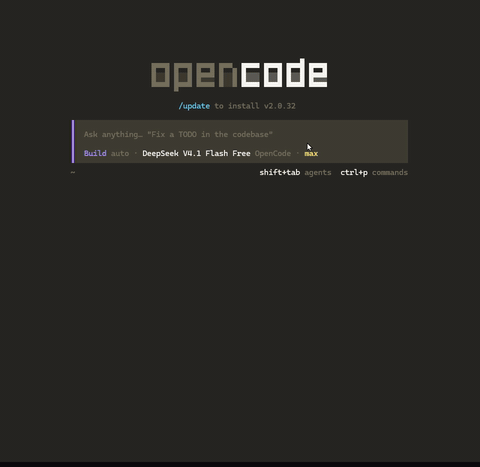
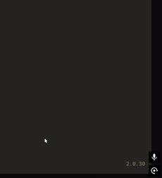

# SOBER-STT-8GB

Ditada por voz local para Windows. Pequeno de propósito: um gesto, nada para configurar, zero VRAM quando parado. Ajustado para placa de 8 GB.


[English](README.md)



Toque duas vezes no **CapsLock** e segure, fale, solte. A fala é transcrita localmente, limpa por um LLM local e colada na janela em foco. Com os modelos quentes, a ditada sai em cerca de um segundo numa RTX 3070.

## Foco

Quatro restrições moldam tudo aqui.

- Um gesto. Dois toques no CapsLock e segurar, nada para vincular, nada para abrir antes da primeira ditada. O CapsLock continua sendo CapsLock no resto do tempo, e os tempos do gesto são constantes no topo do `voice-tray.ahk` se você quiser ajustar.
- Plug and play. O instalador traz o runtime, os modelos e os binários CUDA, não pede permissão de administrador e grava todos os caminhos da máquina no `config.json`, então a pasta pode ir para outro PC.
- Zero VRAM parado. Os modelos sobem sob demanda e morrem 60 s depois da última ditada, ou na hora ao sair. É isso que faz uma placa de 8 GB bastar. O preço é o disco: cerca de 5 GB de modelos.
- Poucas peças móveis. O runner é um arquivo Node só, sem dependência de npm, a gravação é um único host PowerShell persistente, e o pipeline mora numa pasta `lib/` vendored.

Só NVIDIA, por enquanto. Os dois motores vêm em builds CUDA, e é daí que sai o alvo de 8 GB. Em AMD não é plug and play: o llama.cpp publica builds Windows com Vulkan, o whisper.cpp não, então a transcrição ali precisaria de um build a partir do código ou rodaria em velocidade de CPU.

## Instalação

Baixe o `SOBER-STT-Setup-*.exe` em [Releases](https://github.com/gabriel-macherini/SOBER-STT-8GB/releases/latest) e execute. O assistente pede uma pasta (padrão `%LocalAppData%\SOBER-STT-8GB`, sem precisar de administrador) e um idioma de interface, depois checa sua GPU. Ele lista exatamente o que vai baixar: cerca de 5 GB de modelos e binários CUDA, pulando o que já existe. Nada mais é necessário na máquina de destino, nem Node, nem AutoHotkey, nem clone.

| Precisa de | Mínimo | Observações |
|---|---|---|
| Sistema | Windows 10/11 x64 | O gravador e a colagem são exclusivos do Windows |
| GPU | NVIDIA, 6+ GB de VRAM | Tudo que o instalador traz é CUDA; AMD exigiria um build Vulkan manual |
| Disco | ~6 GB livres | Cerca de 5 GB baixados, mais a área de trabalho durante a instalação |
| Microfone | Qualquer entrada padrão do Windows | Veja Configurações > Privacidade > Microfone se nada gravar |
| Shell | PowerShell 7 | Cai para o `powershell.exe` 5.1 sozinho |

## Uso

1. Toque duas vezes no **CapsLock** e segure o segundo toque. O overlay mostra as barrinhas do microfone.
2. Fale.
3. Solte. O texto limpo é colado onde está o cursor.

As barrinhas carregam a cor da fase: verde gravando, laranja transcrevendo, azul normalizando. O Esc cancela uma gravação. O menu da bandeja tem os toggles, a troca de modelo, os atalhos de pasta e o Sair, que libera a VRAM na hora.



## Como funciona

```
CapsLock (app de bandeja em AutoHotkey)
   │  dois toques e segurar → POST /start
   ▼
rec-host.ps1 ── microfone ──► sober-stt.wav (+ nível 0-100 ao vivo)
   │  soltar → POST /stop (assíncrono, devolve {seq} na hora)
   ▼
parakeet-cli ──► texto cru ──► s1 (EN) / Qwen (PT/FR) ──► texto limpo
   │  GET /result?seq=N
   ▼
clipboard + Ctrl+V ──► janela em foco
```

O app de bandeja e o runner Node conversam só por loopback, atrás de um token por inicialização, então uma página web não alcança seu microfone.

- O `/stop` responde na hora e a bandeja consulta o resultado, então o overlay continua se repintando durante a transcrição e a normalização.
- A gravação pré-aquece o Qwen em segundo plano. O s1 fica sob demanda para preservar VRAM.
- O prompt do normalizador vem junto com o app e corrige pontuação, vícios de linguagem e homófonos de código (`Jason` para `JSON`), mantendo o idioma em que você ditou.

## Privacidade

O áudio nunca sai da máquina. Transcrição e normalização rodam localmente, e o único acesso à rede é o instalador buscando modelos e binários uma vez, no Hugging Face e no GitHub. O WAV é apagado depois de cada ditada. A última transcrição fica em `%TEMP%\sober-stt.last.json` a menos que você desligue o `keepLastJson`.

## Documentação

| Doc | O que tem |
|---|---|
| [configuração](docs/configuration.md) | chaves do `config.json`, constantes do overlay, trocar de modelo |
| [api](docs/api.md) | endpoints de loopback, o token, exemplo em PowerShell |
| [problemas comuns](docs/troubleshooting.md) | nada grava ou cola, logs, conflito de porta |
| [build](docs/building.md) | rodar do código, builds portable e instalador, release, CI |
| [máquina de referência](docs/machine-setup.md) | a máquina em que foi ajustado, latências medidas |
| [lib vendored](docs/vendor-lib.md) | de onde vem a `lib/` e como atualizar |

## Créditos e licenças

MIT para este repositório. O instalador baixa pesos e binários de terceiros: Parakeet TDT v3 (NVIDIA, CC-BY-4.0), Qwen3 (Apache-2.0), builds do llama.cpp e do whisper.cpp (MIT), s1-mini (veja o model card). Confira os termos de cada upstream.

## Licença

MIT, veja [LICENSE](LICENSE).
